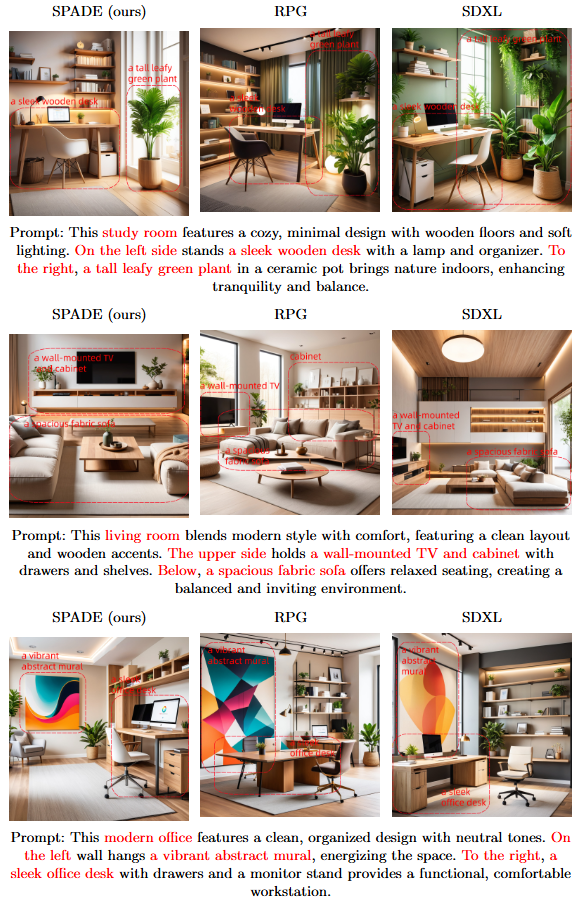
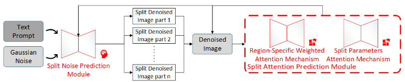
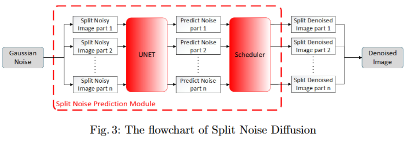
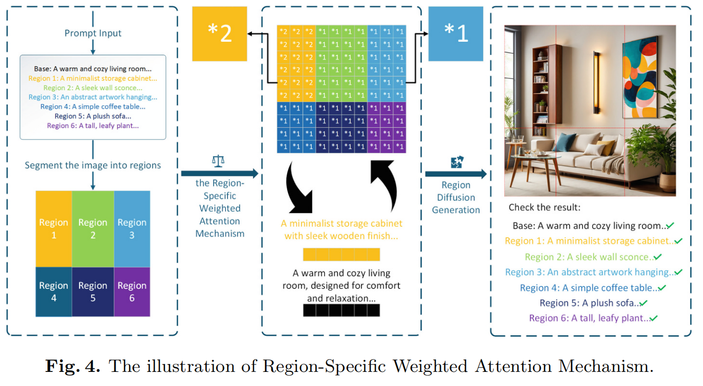
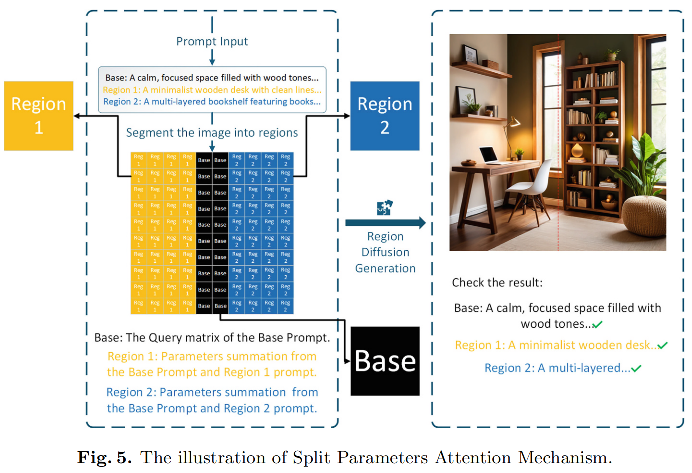

Abstract

Diffusion models generate highly realistic images from text, enabling wide applications. However, they often struggle with ambiguous object positioning for multiple objects in a prompt. While recent methods like Complementary Regional Diffusion define positions via segmentation, constraining diffusion regions may reduce object recognizability and fail to solve the positioning problem, primarily due to insufficient pixel-level control over object regions during noise prediction. To address these issues, we propose Spatial Positioning via Attention-guided Diffusion without Extra Training (SPADE). First, we introduce Split Noise Prediction Method, which partitions prediction regions for individual objects prior to noise prediction, significantly enhancing positional accuracy and object recognizability. Second, we propose Split Attention Prediction Method, integrating Region-Specific Weighted and Split Parameters attention mechanisms. This enhances positional accuracy while countering overall image integrity degradation introduced by the Split Noise Prediction Method. Finally, quantitative evaluation on T2I-CompBench shows SPADE surpasses Complementary Regional Diffusion by 27.6\% in spatial relationship. Qualitative comparisons further confirm superior prompt alignment in generated images. Consequently, SPADE significantly enhances diffusion models' practicality in interior layout design.

Introduction

Recent research on diffusion models has led to remarkable advancements. Numerous application studies have emerged, including DreamBooth and Collaborative Diffusion. However, existing models often struggle with precise spatial positioning when generating multiple objects. Several strategies have been proposed to address this issue, such as complementary regional diffusio. These methods offer innovative solutions to improve positional accuracy. However, a major limitation persists: restricting diffusion regions for precise spatial positioning may degrade object recognizability. Conversely, enhancing recognizability often reduces positional accuracy. Furthermore, improvements in spatial accuracy remain limited in magnitude. This constitutes a significant challenge. 

To overcome this limitation, we propose Spatial Positioning via Attention-guided Diffusion without Extra Training (SPADE), which is developed based on the following strategies: (1) Split Noise Prediction Method adjusts noise regions to enable region-specific predictions, where each distinct region corresponds to a different object. It utilizes integrated noise prediction in subsequent denoising steps. After several denoising iterations, the initial positions of objects within the image can be preliminarily determined. By dividing the image into object-specific regions, this approach reduces gradient conflicts and improves both object positional accuracy and recognizability. (2) Split Attention Prediction Method enhances positional accuracy through attention weighting and region control, and it also addresses the image integrity degradation introduced by the Split Noise Prediction Method. In this mechanism, the Query comes from the hidden states of the noisy image, while the Key and Value are derived from the hidden states of the base and region prompts. Firstly, the \textbf{Region-Specific Weighted Attention Mechanism} enhances object positioning by adaptively increasing the Query matrix weights of target regions, thereby strengthening their association with corresponding objects and improving positional accuracy. Secondly, the \textbf{Split Parameters Attention Mechanism} improves positional accuracy by modifying the region of the Query matrix of an object, directly influencing pixel values via controlled pixel-level adaptation. Experimental results show notable improvements in both qualitative and quantitative evaluations. The generated interior layout images are compared with those from baseline models RPG and SDXL.

Our main contributions are summarized as follows:

We propose the Split Noise Prediction Method, which partitions noisy images into distinct regions for per-region noise prediction, allowing different regions to specialize in generating different objects and thereby enhancing positional accuracy and recognizability of objects in generated images.

 We propose Split Attention Prediction Method, incorporating Region-Specific Weighted Attention Mechanism and Split Parameters Attention Mechanism. This method adjusts Query weights in specific regions while integrating their parameters regionally. It thereby enhances positional accuracy and reduces overall image integrity degradation from the Split Noise Prediction Method.

On the specialized positional evaluation benchmark T2I-CompBench, our model demonstrates a 27.6\% improvement over the state-of-the-art models. This work further establishes theoretically and experimentally derived optimal parameter configurations for generating two-object layout images.

The Proposed Model

Overview of Proposed SPADE

In this section, we introduce our model SPADE. SPADE primarily comprises two modules, each specifically designed for distinct phases: the pre-noise prediction stage and the noise prediction process itself. First, the diffusion process begins with complete Gaussian noise, which is denoised separately by the Split Noise Prediction Module to roughly determine object placement, thereby enhancing positional accuracy and object recognizability in the generated images. Second, after several steps of Split Noise Prediction, the remaining denoising steps transition to the Split Attention Prediction Module. This further refines positional accuracy while effectively mitigating the resulting decline in overall image integrity introduced by the Split Noise Prediction Module, thus ultimately generating high-fidelity images.

Split Noise Prediction Module

In this module, the noisy image is segmented, and each segment is individually processed by the U-Net, as shown in the flowchart, to predict the noise corresponding to its associated object. The segmented noisy images are then reassembled into a complete noisy image, which is fed into the scheduler to predict the next-step image. The Noise Segmentation Coefficient (NSC) represents the proportion of each region relative to the entire image. Let $s$ denote NSC in the Split Noise Prediction Module, and let $w$ denote the width of the latent map. The overlap width is $sw+(1-s)w-w=(2s-1)w$. We discuss the following cases depending on the value of $s$:

No overlap($s \leq 0.5$) Gaps introduce discontinuity through zero-valued parameters, enhancing object positional accuracy at the expense of spatial compression, which may consequently reduce object recognizability.

Critical overlap($0.5 < s < 0.625$) Appropriate overlap ensures smooth blending. When $(2s-1)w\in 0\sim \frac{w}{4}$, it empirically balances object positional accuracy and recognizability. The predicted noise parameters in the overlapping regions are summed:
{\epsilon }_{merged}(x)={\epsilon }_{1}(x)+{\epsilon }_{2}(x),x\in [(1-s)w,sw]

Excessive overlap($s\geq 0.625$) When object regions are segmented overly large, these over-summed regions introduce conflicting gradients. This leads to pixel-level artifacts and visual incoherence.

Split Attention Prediction Module

Region-Specific Weighted Attention Mechanism

To enhance control over specific regions of the image, we introduce a Region-Specific Weighted Matrix ${W}_{region}\in {R}^{N*N}$, which adjusts the attention mechanism's Query matrix weights of specific regions during attention computation. The Region Importance Weights (RIW) represent the weighted values assigned to specific regions, with all other regions defaulting to a weight value of 1. This approach aims to fine-tune the focus degree of specific regions. As illustrated. 

The weighted Query matrix is computed as follows: 
\begin{equation}
{Q}_{weighted}=Q\odot {W}_{region}
\end{equation}
where $\odot$ represents element-wise multiplication (Hadamard product).
The proposed Region-Specific Weighted Matrix ${W}_{region}$ enables the application of differentiated weights across regions. Specifically, if a region is of higher focus degree, its corresponding weights in ${W}_{region}$ will be larger, thereby placing greater emphasis on that region during attention computation. The attention weights, now modified by the region-specific weights, is computed as follows:
\begin{equation}
{A}_{region}=Softmax(\frac{{Q}_{weighted}K^{T}}{\sqrt{{d}_{k}}})
\end{equation}
where ${A}_{region}$ represents the modified attention weights, incorporating the region-specific weights. The term $\frac{{Q}_{weighted}K^{T}}{\sqrt{{d}_{k}}}$ computes the similarity between the weighted Query matrix and the Key matrix, where ${d}_{k}$ denotes the dimensionality of the hidden states of the region prompt. 

The modified attention matrix is then applied to the Value matrix to produce the attention output:
\begin{equation}
{Y}_{region}={A}_{region}V
\end{equation}
This attention output ${Y}_{region}$ is characterized by attention concentrated on specific regions. When ${W}_{region}$ increases in target regions, the corresponding regions in ${Q}_{weighted}$ are scaled up. This directly increases the dot-product similarity ${Q}_{weighted}K^{T}$ for those regions, sharpening the softmax distribution. Consequently, the attention matrix ${A}_{region}$ becomes more concentrated on the specific regions, suppressing other regions. For two regions with the initial Query matrices ${s}_{1}$ and ${s}_{2}$, their attention weights after scaling by $\alpha$ become:
\begin{equation}
{A}_{region}=\frac{{e}^{\alpha {s}_{1}}}{{e}^{\alpha {s}_{1}}+{e}^{\alpha {s}_{2}}}
\end{equation}
Once $\alpha$ reaches a critical value, attention weight parameters for the specific region approach 1, and further scaling yields negligible gradient updates. This critical value can be obtained by taking the derivative with respect to ${A}_{region}$:
\begin{equation}
\frac{\partial {A}_{region}}{\partial \alpha}\approx 0
\end{equation}
This saturation effect limits additional gains in positional accuracy.

Split Parameters Attention Mechanism
The Query matrix is cropped by positional matrix $w$ to form ${A}_{obj}$ components, then regionally integrated into a unified Query matrix. The illustration is shown in the fig. \ref{fig5}. The Split-Attention Coefficient (SAC) measures the proportion of central truncation within object regions. When SAC is too large, it increases pixel spacing between objects, hindering proximity constraints like "near" or "next to". Since it does not modify the hidden states of the region prompt Value matrix, object features remain identifiable. Therefore, recognizability is largely unaffected by changes in SAC.

The base prompt attention weights ${A}_{base}$ and region prompt attention weights ${A}_{obj}$ are fused via a weighting parameter base ratio $\beta $:
\begin{equation}
{A}_{final}=\beta {A}_{base}+(1-\beta ){A}_{obj}
\end{equation}
Increasing the base ratio reduces object positional accuracy, as the influence of the region prompt weakens. Due to the lack of region-specific modulation in base prompt features, reducing $\beta$ amplifies the contribution of ${A}_{obj}$ but introduces conflicting gradients at region boundaries:
\begin{equation}
\frac{\partial \mathcal{L}}{\partial {A}_{obj}}\approx  (1-\beta )\frac{\partial \mathcal{L}}{\partial {A}_{final}}
\end{equation}
Large $\beta$ weakens feature gradients from ${A}{obj}$, reducing regional learning. Therefore, higher base ratios impair object positional accuracy. Split Noise Base Ratio (SNBR) and Split Attention Base Ratio (SABR) refer to base ratios in the denoising of Split Noise and Attention Prediction, respectively. Although ${A}{base}$ and ${A}{obj}$ differ in focus, both contain object features, with ${A}{base}$ also aiding object generation.

\subsection{integration strategy}

\noindent Split Noise Prediction and Split Attention Prediction are integrated as illustrated in the fig. \ref{fig6}. When determining the optimal step counts for Split Noise Prediction and Split Attention Prediction, we follow these principles: Firstly, the Split Noise Prediction step count should be sufficient to form regional constraints through iterative denoising. Secondly, a proportional number of Split Attention Prediction steps must be retained to balance positional accuracy, object recognizability and overall image integrity. The Split Noise Prediction Step Count (SNSC) refers to the steps assigned to Split Noise Prediction in a 20-step process, with the rest for Split Attention Prediction. We generated 3000 interior layout images, and the results indicate that the model performs best when the SNSC is set to 2 or 3. Employing higher SNSC values may compromise overall image integrity and fall short of achieving complete problem resolution.

\begin{figure}[ht]
    \centering
    \begin{minipage}{0.45\textwidth}
        \centering
        \makebox[1.1\textwidth][c]{\normalsize Split Noise Diffusion}
        \vspace{0cm}  % 缩小与图片的垂直间距
        
        \begin{subfigure}{0.4\textwidth}
            \centering
            \includegraphics[width=\linewidth]{1.jpg}
        \end{subfigure}%
        \begin{subfigure}{0.3\textwidth}
            \centering
            \raisebox{2.75\baselineskip}{\LARGE \ldots \ldots}
        \end{subfigure}%
        \begin{subfigure}{0.4\textwidth}
            \centering
            \includegraphics[width=\linewidth]{6.jpg}
        \end{subfigure}
    \end{minipage}%
    \hfill
    \begin{minipage}{0.45\textwidth}
        \centering
        \makebox[1.1\textwidth][c]{\normalsize Split Attention Diffusion}
        \vspace{0cm}  % 缩小与图片的垂直间距
        
        \begin{subfigure}{0.4\textwidth}
            \centering
            \includegraphics[width=\linewidth]{7.jpg}
        \end{subfigure}%
        \begin{subfigure}{0.3\textwidth}
            \centering
            \raisebox{2.75\baselineskip}{\LARGE \ldots \ldots}
        \end{subfigure}%
        \begin{subfigure}{0.4\textwidth}
            \centering
            \includegraphics[width=\linewidth]{20.jpg}
        \end{subfigure}
    \end{minipage}
    \caption{Illustration of Module Integration}
    \label{fig6}
\end{figure}

# SPADE
SPADE source code repository
Comming Soon
          --2025.11.15

Code usage instructions coming soon
          --2025.11.21
